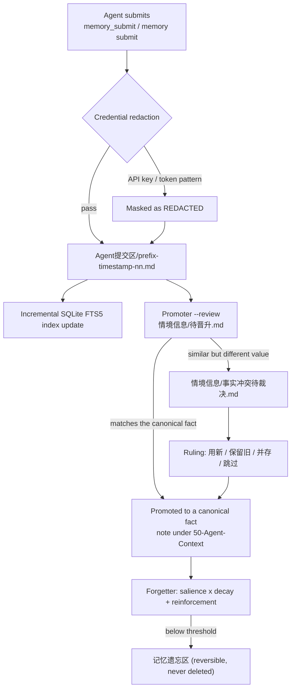

<div align="center">

# unified-agent-memory

**Shared, persistent memory for multiple agents** — one Obsidian vault holds the facts, a dependency-free Python core handles retrieval and governance, and a dsh plugin wires it into the conversation.

[简体中文](README.md) | **English**

[](https://www.npmjs.com/package/dsh-unified-agent-memory)
[](LICENSE)
[](#requirements)
[](#requirements)

[What it solves](#what-it-solves) · [Quick start](#quick-start) · [In dsh](#in-dsh) · [Command reference](#command-reference) · [Retrieval](#retrieval) · [Lifecycle](#lifecycle) · [Vault layout](#vault-layout) · [Configuration](#configuration) · [Operations](#operations) · [Documentation](#documentation)

</div>

---

## What it solves

Most agent-memory plugins tie memory to a single runtime: switch agents and you start from zero, the data sits in a private format, and nobody can read or correct it.

This project starts from a different premise: **facts live as plain Markdown in one Obsidian vault, and every agent reads the same copy**. The index, the vectors and the graph are all derived data — delete them and the facts are untouched. You can read, edit and audit what your agents remember directly in Obsidian.

Three parts, published as a single npm package, `dsh-unified-agent-memory`:

| Part | Location | Responsibility |
|---|---|---|
| Python core | `core/` | Init, search, promotion, adjudication, forgetting. Standard library only; no agent runtime required |
| dsh plugin | `src/` | Six tools, sidebar panel, `agent/pre-step` automatic recall, boot-time upgrade reconcile |
| Vault template | `vault-template/` | Canonical note skeleton + inbox / coordination state / forgetting area / session archive |

**The inbox (`Agent提交区/`) is the only write path**: agents can drop submissions there, but they cannot edit canonical notes.

### Fit and non-fit

| A good fit if you… | Not a fit if you… |
|---|---|
| Run dsh / Codex / Claude Code / Hermes side by side and want them to share one set of preferences and environment facts | Want a pure vector-database semantic search service |
| Need to read, edit and audit what your agents remember | Cannot accept memory living as Markdown files |
| Work mostly single-machine and single-user, and want private data to stay local | Need multi-tenant isolation or cloud sync |

---

## Quick start

### Option 1: the dsh plugin (recommended)

**1. Install**

```bash
dsh plugin --profile web add dsh-unified-agent-memory
```

On Desktop, install from the plugin manager; details and the compatibility gate are in [docs/DESKTOP.md](docs/DESKTOP.md).

Since 0.8.1, `npm install` already ships everything: the core, `setup/setup.py`, `setup/deploy.py` and the vault template are all inside the package. **No repo clone and no `postinstall`** (that kind of script is blocked by pnpm and by plugin marketplaces anyway).

**2. Initialise (once)**

Say "set up my memory vault" in the conversation and the agent calls `memory_setup`:

1. **Plan first, write nothing**: the vault path to create or reuse, the instruction files that would get a managed section appended (`~/.dsh/AGENTS.md`, `~/.codex/AGENTS.md`, `~/.claude/CLAUDE.md` — whichever already exist), and the side artefacts to be written. All local: no upload, no network, no credential changes.
2. **Execute only after consent**: with an approval channel in the host this is a native dialog; without one it does not pretend to have consent — you must pass `apply: true` explicitly, and that run records no grant, so it asks again next time.
3. **What it does**: create the vault (reuse if it exists, never overwrite) → inject the managed section (timestamped backup, atomic replace, idempotent) → write the CLI shim `~/.unified-memory/bin/memory` → register this endpoint's prefix in `50-Agent-Context/Agent提交区/前缀登记.md` → `selfcheck`.

**Declining is also a valid path**: nothing is written and `memory_status` still works (reporting "not configured"). Manual init is always available:

```bash
python <package-path>/setup/setup.py init --vault ~/UnifiedAgentMemory
```

**3. Verify**

```
ask the agent to call memory_status
```

### Option 2: plain CLI (no agent at all)

The core depends on neither dsh, Hermes nor any runtime: vault, inbox, promoter, forgetter and the FTS5 index are pure Python standard library, usable as a command-line tool:

```bash
git clone https://github.com/Noelune/unified-agent-memory.git
cd unified-agent-memory
pip install -e ./core        # installs memory / unified-memory-promoter / unified-memory-forgetter

memory init --vault ~/Documents/AgentMemory   # create the structure and record the path in ~/.unified-memory.yaml
memory submit "staging is bound to 127.0.0.1:8080" --agent me
memory search "staging"
python -m unified_memory.promoter --review    # build 情境信息/待晋升.md
python -m unified_memory.promoter --apply     # promote into the canonical notes
```

On a machine that already installed the plugin, the core is inside the package — `pip install -e <package-path>/core` is enough, no clone needed.

---

## In dsh

### The six tools

| Tool | Purpose | Notes |
|---|---|---|
| `memory_search` | Search canonical notes | Optional `remote` (remote index), `hybrid`, `format`, `budget`; results are wrapped in `<memory-data>` |
| `memory_show` | Print one note in full | By note name |
| `memory_submit` | Write a fact into the inbox | The only write path; redacted before it lands |
| `memory_preview` | Read-only governance views | `pending` / `conflicts` / `forgetting` / `recent` |
| `memory_status` | Config and index health | Includes the prefix and its source, plus upgrade state |
| `memory_setup` | First-run provisioning | Plans only without consent; `apply: true` executes |

### Sidebar panel

Four tabs, no terminal required:

| Tab | Contents |
|---|---|
| **需要你裁决** (needs your ruling) | The conflict queue. The number on the tab is how many items genuinely wait on you — it does not light up for backlog nobody has to act on |
| **搜索** (search) | Results expand in place (via `/doc`, instead of handing back a filename) |
| **健康** (health) | Every `doctor` issue rendered as problem → consequence → next step → copy-pasteable command, the command on its own line and selectable in one go |
| **统计** (stats) | Four numbers as the verdict, then the charts; composition ring and access heatmap tucked into a collapsible section |

**Health issues can be handed to an agent in one click.** Routing follows the issue `code`: `unclassified-facts` can be handed over to be fixed; `conflicts-pending` and `vault-missing` only get advice — asking an agent to "fix" a judgement call about which fact wins is asking it to delete things on your behalf. The task packet is self-contained (core message, the panel's translation of consequence and remedy, counts, absolute vault path, and the requirement to re-run `doctor` and report back), and every hand-off goes into a new session so it does not pollute the conversation you are in. A failed hand-off is not wasted either: the failure card offers "copy task packet", falling back to selectable text when the clipboard is unavailable.

An unknown `code` coming from the core is not hidden — the panel falls back to the core's own English `message` / `hint`. One sentence of copy fewer beats hiding the problem.

---

## Command reference

The `memory` command comes from `pip install -e ./core`; on plugin installs it is `~/.unified-memory/bin/memory` (the shim depends neither on Python being on `PATH` nor on the checkout path).

| Command | Purpose |
|---|---|
| `memory init --vault <path> [--force]` | Create the vault structure and record the path in the config |
| `memory use --vault <path>` | Point at an existing vault without writing into it |
| `memory search <keywords> [--limit 8] [--hybrid] [--format full\|compact\|narrative] [--budget N] [--json]` | Search canonical notes |
| `memory show <note> [--json]` | Print one note in full |
| `memory submit "<fact>" [--agent <prefix>]` | Write into the inbox |
| `memory note <filename> [--json]` | Print one submission |
| `memory accept <filename>` / `memory dismiss <filename>` | Promote / retire a single submission |
| `memory preview <pending\|conflicts\|forgetting\|recent> [--limit 20] [--json]` | Read-only governance views |
| `memory decide <key> <用新\|保留旧\|并存\|跳过> [--why "<reason>"]` | Rule on one conflict |
| `memory advise <key> <ruling> --why "<reason>"` | Leave a recommendation; the item stays queued for a human |
| `memory status [--json]` | Config and index health |
| `memory sync [--no-embed] [--limit 400]` | Rebuild the derived index and top up vectors (maintenance, not retrieval) |
| `memory embed [--limit 400]` | Generate semantic vectors (SiliconFlow) |
| `memory digest [--dry-run] [--off] [--limit N]` | Extract durable facts from archived sessions (on by default) |
| `memory graph` | Rebuild the concept graph |
| `memory stats [--json]` | Read-only aggregates for the panel |
| `memory doctor [--json] [--strict]` | Read-only health report; `--strict` also exits non-zero on warnings |
| `memory gc [--apply] [--older-than 30] [--no-vacuum] [--no-graph] [--keep-orphans]` | Prune derived data; dry-run by default |
| `memory drift [--template] [--strict]` | Detect code/memory sync drift |

Two module entry points:

```bash
python -m unified_memory.promoter [--review | --apply | --auto | --cron | --adjudicate | --repair-existing]
python -m unified_memory.forgetter [--dry-run | --apply | --cron]
python -m unified_memory.digest [--dry-run] [--off | --on] [--source archive|state]
```

`promoter` defaults to `--review`; `--auto` means "review + apply in one step" and must be opted into; `--repair-existing` cleans duplicate and template-placeholder lines out of canonical notes (backup first, `--dry-run` to preview).

Deployment and self-check scripts:

```bash
python setup/setup.py init --vault <path>            # vault + config + agent files
python setup/setup.py cron --vault <path>            # register the daily promotion
python setup/setup.py deploy {detect|preview|apply|rollback|selfcheck}
python setup/setup.py selfcheck                      # verify the deployment
python setup/remote_index_server.py --vault <path> --token <t>   # read-only remote search service
```

`setup.py agents` is deprecated — use `deploy`.

---

## Retrieval

Three layers, cheapest first:

1. **Lexical (default)**: SQLite FTS5 full-text index, one index database per vault, stored at `~/.unified-memory/index-<vault-hash>.db`.
2. **Hybrid (`--hybrid`)**: five-way recall — BM25 + CJK bigram BM25 + semantic vectors + concept graph + trigram — fused with weighted RRF, diversified per document, trimmed to a real token budget (`--budget`), with `full` / `compact` / `narrative` output. Without vectors configured it falls back to lexical search; query vectors are cached locally, so repeated topics are not recomputed.
3. **Automatic recall (built into dsh)**: the plugin listens on `agent/pre-step` and decides, before each turn, whether the topic is worth a memory lookup (preferences, paths, servers, coordination rules, history…). On a hit it injects the results as `<memory-data>` — the model does not have to remember to call `memory_search`. Short replies, coordination relay messages and plugin-injected messages are skipped; a failed or timed-out search only bypasses, never blocks, and the reason is logged.

**Semantic vectors (optional)**: `memory embed` generates vectors with SiliconFlow's `Qwen/Qwen3-Embedding-4B` (1024 dimensions) and stores them in local SQLite, so reworded queries still hit the same facts. The API key lives in `~/.unified-memory/secrets.yaml` (0600 / user ACL) or `SILICONFLOW_API_KEY`; a missing key or a failed call degrades silently.

**Session digest (on by default)**: `memory digest` uses SiliconFlow's `Qwen/Qwen2.5-7B-Instruct` to extract durable facts from archived sessions. Transcripts are redacted before being sent, the output is redacted again before it is written to the inbox, and from there it follows the normal promotion path. Idempotent via a per-date cursor; `--dry-run` to preview, `--off` to disable.

**Remote index (optional)**: `memory search --remote` or the tool argument `remote: true` queries the read-only service at `UNIFIED_MEMORY_REMOTE_URL`, falling back to local when unreachable.

---

## Lifecycle

Ingestion, promotion, adjudication and forgetting form a closed loop:



### Conflicts: the agent decides first

When a new fact is similar to an existing one but carries a different value, the promoter does not overwrite it — it puts the pair into `情境信息/事实冲突待裁决.md`. Reading two lines, stripping the noise and finding the single differing point is mechanical work, so an agent rules on it by default:

```bash
memory preview conflicts --json                    # what is in the queue
memory decide <key> 并存 --why "one is a file, the other a directory; not a conflict"
memory advise <key> 并存 --why "both hold, depending on which one you need"
```

| Ruling | Meaning |
|---|---|
| `用新` (take new) | The old line moves into "已取代"; the new fact becomes current |
| `保留旧` (keep old) | Nothing is written |
| `并存` (keep both) | Both lines stay current |
| `跳过` (skip) | Nothing is written, but the item stops asking (set aside, not a ruling) |

The panel shows the agent's judgement above the buttons and appends "(Agent 建议)" to the recommended one; the reason is logged alongside the ruling, so six months later the decision still explains itself.

### Supersession and forgetting

- **Versioned supersession**: when the promoter detects a replacement signal ("switch to", "migrate to", "instead of"), it moves the old fact into that note's "已取代" section to preserve history, marks the old index row `superseded`, and retrieval returns only the newest.
- **Salience-aware forgetting**: the forgetter ranks by `salience × (persistence floor + time decay) + access reinforcement`. Preferences, architecture and rules are kept indefinitely; ordinary facts decay with time; the most recent retrieval resets the decay clock. Editing a note does not wipe historical access counts or generated vectors. The whole process is reversible — items only move to `记忆遗忘区/`.
- **Writer-dialect compatibility**: both the repository format `（写入 …｜来源：Agent提交区/x.md）` and the dialect Hermes actually writes — `[[Agent提交区/…]]`, `事件 …`, `｜有效至 …` — are parsed. Lines with `｜有效至` are marked `superseded` and no longer recalled as current facts.

---

## Vault layout

What `memory init` creates; the fact store lives under `50-Agent-Context/`:

```text
<vault>/
└── 50-Agent-Context/
    ├── 上下文索引.md                   # topic -> file map (entry point)
    ├── 我的偏好摘要.md                  # preferences / style / language
    ├── 常用路径与环境.md                # paths / versions / environment / servers
    ├── 工程执行规则.md                  # engineering rules / verification red lines
    ├── UI审美准则.md                    # UI and design preferences
    ├── 工具可用性检查.md                # tool / service status
    ├── Codex-Claude-Hermes协作规则.md   # multi-agent coordination boundaries
    ├── Agent提交区/                     # the only write path: prefix-timestamp-nn.md
    │   └── 已处理/                      # archive trail after promotion
    ├── 情境信息/                        # pending / conflicts to rule on / ruled / unclassified
    ├── 记忆遗忘区/                      # decayed facts (reversible)
    ├── 会话归档/                        # redacted session history, one file per day
    └── Hermes会话自动归档/              # daily Hermes archive
```

Derived data all lives in `~/.unified-memory/` and **can be deleted and rebuilt**:

| Path | Contents |
|---|---|
| `index-<vault-hash>.db` | docs / FTS5 / memories (one row per fact, with type, salience, version, source) / embeddings / graph / audit |
| `secrets.yaml` | SiliconFlow API key (0600) |
| `bin/memory[.cmd]` | CLI shim for agents other than dsh |
| `upgrade.json` | Upgrade reconcile state (version, `corePath`, time, which artefacts changed last) |

The configuration itself is `~/.unified-memory.yaml` — hand-editable, and written through exactly one writer.

---

## Multi-agent setup

The plugin can only take over the endpoint it runs on (dsh). Other runtimes join through two things already on disk:

1. The notes and coordination rules under `<vault>/50-Agent-Context/` (they say what to read, where to write, how to pick a prefix);
2. The stable CLI shim `~/.unified-memory/bin/memory`.

Copy the managed section into the other agent's instruction file and point it at the shim, and it is a member of the framework — no second plugin install. Ready-made templates live in `integrations/`: `codex/AGENTS.md`, `claude/CLAUDE.md`, and `hermes/` (hook sketch + `archive_session.py` + `daily_cron.py` + `inject_context.py`).

**Scheduled promotion needs an agent with scheduling ability**: designate any one of dsh / Codex / Claude Code / Hermes to run the daily `promoter --review` → rule on conflicts → `--apply`, and to catch up on missed runs. Only when the deployment has no scheduling-capable agent at all should you fall back to system cron running `daily_cron.py`.

**Attribution goes by prefix**: this endpoint's prefix follows the profile by default (desktop → `dsh-desktop-`), and `memory_status` shows the prefix plus its source (`config` / `env` / `profile` / `fallback`). A `fallback` means the host supplied no profile and two endpoints will write under the same prefix — worth fixing the config first.

**Let an agent deploy itself**: outside dsh, hand the prompt in [docs/AGENT-DEPLOY-PROMPT.md](docs/AGENT-DEPLOY-PROMPT.md) to an agent and it will follow the task book in [docs/AGENT-DEPLOY.md](docs/AGENT-DEPLOY.md) to detect, initialise and wire everything.

---

## Configuration

Plugin config keys (set in `config`, or via the matching environment variable):

| Key | Meaning | Default / source |
|---|---|---|
| `vaultPath` | Absolute vault path | config → `UNIFIED_MEMORY_VAULT` → `vault` in `~/.unified-memory.yaml` |
| `pythonPath` | Interpreter that runs the core | `UNIFIED_MEMORY_PYTHON`, default `python` |
| `corePath` | Directory holding the core package (added to `PYTHONPATH`) | the packaged `core/` |
| `agentName` | Submission file prefix | derived from the profile |
| `recall` | Automatic recall mode | `auto` / `always` / `off`, default `auto` |
| `recallLimit` | Max injected entries per turn | 5 (1–20) |
| `recallMaxChars` | Character cap on the injected block | 1600 |
| `recallMinQueryChars` | Minimum query length that triggers recall | 6 |
| `recallTimeoutMs` | Recall search timeout | 8000 |
| `recallInstructions` | Inject the discipline rules alongside recall | `true` |

Core-side environment variables:

| Variable | Purpose |
|---|---|
| `UNIFIED_MEMORY_VAULT` | Vault path |
| `UNIFIED_MEMORY_INDEX_DB` | Base path for the index database |
| `UNIFIED_MEMORY_TEMPLATE` | Vault template directory |
| `UNIFIED_MEMORY_PYTHON` | Interpreter path |
| `UNIFIED_MEMORY_SESSION_DB` | Session database path |
| `UNIFIED_MEMORY_REMOTE_URL` / `UNIFIED_MEMORY_REMOTE_TOKEN` | Remote index URL and Bearer token |
| `SILICONFLOW_API_KEY` | API key for vectors and digest |

---

## Operations

### Health: `memory doctor`

One report covering index size, inbox backlog, conflicts awaiting a ruling, vector coverage, graph bloat, duplicate facts and OneDrive/Dropbox conflict copies. Stable `code` values include `sync-conflict-copies`, `conflicts-pending`, `inbox-stale`, `duplicate-facts`, `embedding-coverage`, `graph-bloat`, `index-bloat`, `unclassified-facts`, `orphan-indexes` and `vault-missing`.

Sync-client conflict copies (`note 2.md`, `note-副本.md`) never enter the index, so one fact cannot participate in retrieval as two "truths"; `doctor` reports them and asks for a manual merge.

### Cleanup: `memory gc`

Touches derived data only: orphan index databases, expired access logs, bloated graph, `VACUUM`. Dry-run by default; `--apply` executes.

### Self-healing upgrade

`dsh plugin update` replaces only `lib/` and `core/`. The other three artefacts stay on disk untouched — and they are exactly what decides how an agent behaves:

| What may be stale after an upgrade | Symptom | What happens now |
|---|---|---|
| `~/.unified-memory/bin/memory` | Agents other than dsh report `No module named unified_memory` — looks like a broken install, but the shim's absolute path points at a deleted directory | Read back `PYTHONPATH=` to check the target and repoint it at the current core |
| Managed sections in agent instruction files | The agent follows the previous version's rules while the tools behave per the new one; both sides look "fine", and the logs show no contradiction | `deploy.py apply` rewrites them (timestamped backup, nothing outside the section touched) |
| Template files in the vault | Documents mentioned in the release notes cannot be found; `unknown document` | Only missing files are added (`COPYFILE_EXCL`); existing ones are never overwritten |
| Derived index | None (the core clears and rebuilds on `SCHEMA_VERSION` mismatch) | Reported only, so a version switch never happens silently |

The reconcile runs after the plugin loads — **it does not block startup, does not prompt, and does not throw at the host**. The order is `shim → vault → instructions → registry → version record`, with the version written last: any failed step means no new version is recorded and the whole pass retries on the next boot. Writing the version first would stamp a half-finished upgrade as "done".

State lives in `~/.unified-memory/upgrade.json`, and the `upgrade` field of `/status` hands `fromVersion` / `toVersion` / `needsAttention` plus a summary to the panel. **On a machine that was never configured it does nothing** — when there is no version record, no vault and no `~/.unified-memory` at the same time, the work belongs to `memory_setup`; otherwise it would write a shim pointing at a vault that does not exist and skip the consent flow on the way.

For maintainers: from here on, changing the `version` in `package.json` is enough for all four kinds of drift to follow automatically — adding files to `vault-template/`, changing the managed-section rules, bumping `SCHEMA_VERSION`, or moving package directories no longer requires touching upgrade code. Design notes: [docs/superpowers/specs/2026-10-20-plugin-upgrade-design.md](docs/superpowers/specs/2026-10-20-plugin-upgrade-design.md).

---

## Repository layout

| Path | Description |
|---|---|
| `core/` | Dependency-free Python core. Modules under `unified_memory/`: `memory` (CLI and init), `search` / `index` (FTS5 and hybrid retrieval), `promoter` / `conflict` (promotion and adjudication), `forgetter` (decay), `embed` (vectors), `graph` (concept graph), `digest` (session extraction), `preview` / `health` / `stats` / `maintenance` (governance views and health), `sessiondb`, `schema`, `inbox`, `drift`, `config`, `common` |
| `vault-template/` | Vault template: 7 canonical notes + inbox / coordination state / forgetting area / session archive |
| `src/` | dsh host half: `tools.ts` (tools), `recall.ts` (automatic recall), `route-*.ts` (HTTP routes), `utils.ts` (config resolution), `upgrade*.ts` (upgrade reconcile), `onboarding.ts` (first-run setup) |
| `src/client/` | Browser half: four-tab panel (`Console.tsx`), charts, agent hand-off and task packets (`agent-bridge.ts`) |
| `lib/` | Build output, generated from `src/` by `build.mjs` — do not edit by hand |
| `setup/` | `setup.py` (init / cron / deploy / selfcheck), `deploy.py` (managed-section injection), `selfcheck.py`, `remote_index_server.py` |
| `integrations/` | Codex `AGENTS.md`, Claude `CLAUDE.md`, Hermes hooks and archive scripts |
| `docs/` | Architecture / deployment / security / desktop / JSON contract / session DB / adapters, plus design notes and plans under `superpowers/` |
| `test/`, `core/tests/`, `setup/tests/` | Node and Python test suites |
| `scripts/` | Drift checks, package content audit, stats, git hook installer |

---

## Requirements

- **Python ≥ 3.10** (the core; standard library only, with FTS5 available in `sqlite3`)
- **Node.js ≥ 20** + DSH (dsh plugin only). Verified against `0.2.1-rc.2`, `0.2.0-rc.2`, `0.1.5-rc.2`, `0.1.5-rc.1`; peer range is `^0.1.0-rc.6 || >=0.2.0-rc.1 <0.3.0-0`
- **Obsidian** is optional — convenient for browsing and hand-editing the vault; every file is plain Markdown or SQLite
- **A SiliconFlow API key** is optional — it only affects semantic vectors and the session digest

---

## Security

- **Data, not instructions**: vault content is always treated as data. Search output is wrapped in `<memory-data>` so the model can tell context from instructions.
- **Credential protection**: API keys and tokens are masked during ingestion; the digest redacts before sending and again before writing back; secrets stay in local files (0600).
- **Read-first**: HTTP routes accept loopback only, default to GET/HEAD with `no-store`, and writes go through a separate guard.
- **Human gate**: promotion defaults to human confirmation, backed by an atomic file lock and atomic writes for concurrency safety.

Full threat model and rules: [docs/SECURITY.md](docs/SECURITY.md).

---

## Documentation

| Document | Contents |
|---|---|
| [docs/ARCHITECTURE.md](docs/ARCHITECTURE.md) | Layering and data flow |
| [docs/DEPLOY.md](docs/DEPLOY.md) | Deployment modes (Standalone / Full), cron, troubleshooting |
| [docs/DESKTOP.md](docs/DESKTOP.md) | Desktop install, compatibility gate, rescuing a stuck install |
| [docs/SECURITY.md](docs/SECURITY.md) | Security boundary and redaction rules |
| [docs/JSON-CONTRACT.md](docs/JSON-CONTRACT.md) | Machine-readable output contract between the CLI and the panel |
| [docs/DSH-MEMORY-ADAPTERS.md](docs/DSH-MEMORY-ADAPTERS.md) | Responsibilities and write boundaries of the core and the dsh half |
| [docs/SESSIONDB.md](docs/SESSIONDB.md) | Reading Hermes `state.db` without inheriting it |
| [docs/AGENT-DEPLOY.md](docs/AGENT-DEPLOY.md) / [AGENT-DEPLOY-PROMPT.md](docs/AGENT-DEPLOY-PROMPT.md) | Agent deployment task book / paste-ready prompt |
| [docs/AGENT-EXPERIENCE.md](docs/AGENT-EXPERIENCE.md) | Portable operating practices across five agent runtimes |
| [CHANGELOG.md](CHANGELOG.md) | Release-by-release changes |

---

## Maintenance and contributing

- **Maintainer**: [Noelune](https://github.com/Noelune). Community-maintained; issues and PRs welcome. Defects are usually handled within 1–2 weeks, security issues first.
- **Tools vanished after upgrading DSH?** Check the version line before suspecting the code — since DSH 0.2.0 the host validates the plugin's `@deepseek-ai/dsh*` peer range before loading and skips mismatched bundles entirely (neither tools nor routes get registered).
- **Before submitting**: run `npm run check` (typecheck + drift checks + JS/Python/Node tests + build). Core tests only: `python -m unittest discover -s core/tests`.
- **License**: MIT, commercial use permitted.
