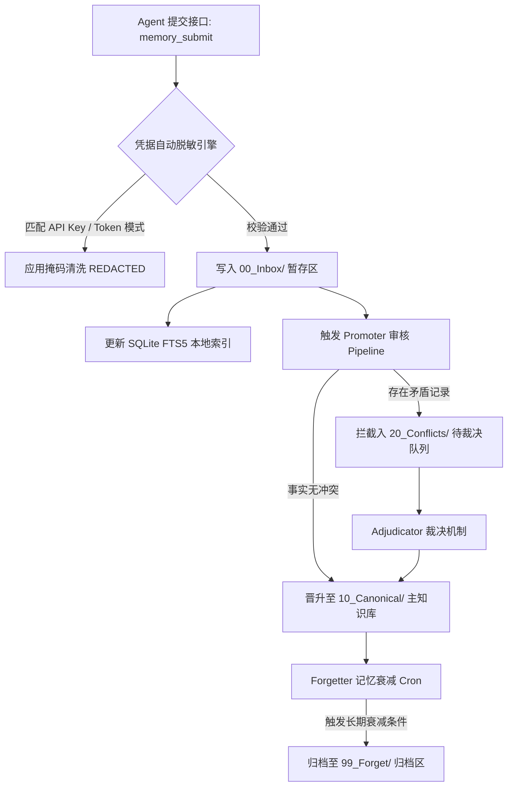
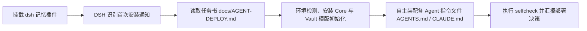

<div align="center">

<a href="docs/images/logo.jpg"></a>

# 🧠 unified-agent-memory

### *Unified Fleet-Wide Agent Memory System for DeepSeek Harness & Multi-Agent Runtimes*

*跨 Agent 统一持久化记忆系统 — 基于 Obsidian Vault 存储规范与 SQLite FTS5 本地索引的知识生命周期管理基座*

[](https://www.npmjs.com/package/dsh-unified-agent-memory)
[](LICENSE)
[](#)
[](#)
[](#)

[产品定位与问题定义](#-产品定位与问题定义) • [核心技术优势](#-核心技术优势) • [Obsidian 存储规范](#-obsidian-vault-存储结构规范) • [Agent 全流程自动部署](#-agent-全流程自动部署流程) • [生命周期控制流](#-知识生命周期控制流) • [安全隔离与防护机制](#-安全隔离与凭据脱敏机制)

</div>

---

## 📌 产品定位与问题定义

传统 Agent 记忆插件多数绑定于特定的 Agent 运行时（Single-Agent Scope），其存储空间与会话相互隔离，缺乏统一的状态持久化与跨代理知识共享能力。

**`unified-agent-memory` 架构旨在为多 Agent 舰队提供统一的知识管理基座**：它允许 `dsh`、`Codex`、`Claude Code` 与 `Hermes` 等多个独立代理共享基于 Markdown 规范的 Obsidian Vault 知识仓库，配合纯 Python 标准库核心与 SQLite FTS5 本地索引，构建涵盖**知识摄取 (Ingestion)、知识晋升 (Promotion)、冲突裁决 (Adjudication) 与衰减遗忘 (Decay/Retention)** 的全闭环生命周期管理系统。

核心与 DSH 适配层分层维护，具体职责和写入边界见
[docs/DSH-MEMORY-ADAPTERS.md](docs/DSH-MEMORY-ADAPTERS.md)。两者以单个包
`dsh-unified-agent-memory` 发布：`core/` 是纯 Python 核心，`src/` 是 DSH 宿主
半边（工具、路由、`agent/pre-step` 自动召回），收件箱是唯一写入通道。

装好之后它不只是后台跑：桌面端侧边栏有四个页签（概览 / 搜索 / 健康 / 统计），
健康页把每个体检问题讲成「问题 → 后果 → 下一步 → 命令」，并且可以直接把问题
交给一个新会话里的 Agent 去修。升级也不再需要手工补步骤——插件自己核对 shim、
托管段与 vault 模版是否还跟得上当前版本。

---

## 🚀 核心技术优势

- **统一单一真理来源 (Shared Source of Truth)**  
  全 Fleet 代理共享一致的 Markdown 知识库规范。开发者与用户可直接借助 Obsidian 等编辑器可视化审计、人工校验或修改代理积累的知识节点。
- **纯 Python 标准库核心 (Zero-Dependency Engine)**  
  `core/` 模块完全基于 Python 标准库（`sqlite3`, `json`, `hashlib`, `argparse`, `os`）实现，无外部依赖开销，具备毫秒级冷启动性能。
- **SQLite FTS5 本地全文索引 (Local-First High-Performance Search)**  
  检索索引持久化存储于本地 `~/.unified-memory/index-<vault-hash>.db`，按 Vault 隔离；基于 SQLite FTS5 引擎实现毫秒级全文匹配与相关度计算，数据隐私完全归属于本地宿主机。
- **提示词隔离防护与凭据脱敏 (Prompt Injection Defense & Redaction)**  
  检索输出强制采用 `<memory-data>` 安全隔离标记包装，明确提示 LLM 区分数据上下文与系统指令；知识摄取前自动对敏感凭据（API Keys/Tokens）执行掩码清洗。
- **完整知识生命周期控制 (Full Lifecycle Pipeline)**  
  内置完整的状态流转机制：包含写收件箱暂存、Promoter 知识审核归纳、Adjudicator 冲突事实裁决、Atomic Lock 并发文件锁与 Forgetter 定期记忆衰减归档。
- **混合检索 (Hybrid Retrieval)**  
  `memory search --hybrid` 融合五路召回：BM25 + 中文 bigram BM25 + 语义向量 + 概念图谱 + trigram，加权 RRF 融合、同文档多样化、按真实 Token 预算裁剪。无向量时自动回退词法检索；查询向量本地缓存，重复主题的混合检索约 250ms。
- **自动召回 (Automatic Recall, dsh 内置)**
  插件监听 `agent/pre-step`，在每轮对话开始前判断话题是否「值得查记忆」（偏好、路径、服务器、协作规则、历史等），命中就先把检索结果以 `<memory-data>` 注入上下文——模型不必记得调 `memory_search`。`auto` / `always` / `off` 三档可配，短回复、协作中转消息与插件注入消息一律跳过，检索失败或超时只旁路不阻断。这项能力原先是独立的 `dsh-memory-discipline` 插件，现已并入本包，与工具共用同一套 `vaultPath` / `pythonPath` / `corePath`。
- **真实写入方言兼容 (Writer-Dialect Compatibility)**
  同时解析仓库格式 `（写入 …｜来源：Agent提交区/x.md）` 与 Hermes 实际写入的 `[[Agent提交区/…]]`、`事件 \`…\``、`｜有效至 …` 方言。`｜有效至` 行自动标记为 `superseded`，不再作为当前事实召回。
- **可观测性与自维护 (Doctor & GC)**
  `memory doctor` 一次输出索引规模、收件箱积压、冲突、向量覆盖率、图谱膨胀、OneDrive 冲突副本等问题清单；`memory gc` 只清理派生数据（孤儿索引库、过期访问日志、膨胀图谱、VACUUM），默认 dry-run，`--apply` 才执行。
- **桌面端侧边栏面板 (DSH Sidebar Panel)**
  侧边栏提供四个页签——概览、搜索、健康、统计——不必切终端。**搜索**结果能直接就地展开全文（走 `/doc`，不是把文件名丢给你）；**健康**页把 `doctor` 的每条问题渲染成「问题 → 后果 → 下一步 → 可粘贴的命令」四段，命令单独一行且可一次选中（`user-select: all`），不会让人重打一遍；**统计**页先给四个数字的结论再给图，构成环图与访问热力图收进 `<details>` 折叠。核心新增的未知 `code` 不隐藏，退回核心自己的英文 `message` / `hint` —— 少一句好文案，总好过把问题藏起来。
- **问题可以一键交给 Agent 修 (Repair Hand-off)**
  健康页每张问题卡带「让 Agent 处理」/「让 Agent 分析」。分流按 `code` 走：`unclassified-facts` 这类可以交给它改；`conflicts-pending`、`vault-missing` 只能让它先给建议 —— 让 Agent「修」一个谁赢的判断题，等于让它替你删东西。任务包是自足的（核心原文、面板译好的后果与修法、计数、vault 绝对路径、改完必须重跑 `doctor` 并回帖），且**每次都送进一个新建的会话**，不污染你正在聊的那个。送不出去也不白写：失败卡片带「复制任务包」，剪贴板不可用时退成可框选的文本。
- **升级自愈 (Self-healing Upgrade)**
  一次升级是四件事，npm 只做第一件。插件的 shim、各 Agent 指令文件的托管段、vault 模版文件都不会被 `dsh plugin update` 替换，于是老用户升完级会出现「Agent 照旧规则做事、工具按新行为执行」这种双方都正常却对不上的状态。本版起插件在启动时调度一次核对（不阻塞、不弹窗），按 `shim → vault → instructions → registry → 版本记录` 修补，只补不覆盖、改前备份，版本**最后**写——任何一步失败就下次重试，绝不把半途而废的升级盖章成完成。

- **异步同步副本隔离 (Sync-Conflict Isolation)**
  OneDrive/Dropbox 生成的 `note 2.md`、`note-副本.md` 等冲突副本不会进入索引，避免同一事实以两个“真相”参与检索；`doctor` 会明确报错提示人工合并。
- **语义向量层 (Semantic Embeddings, 可选)**  
  `memory embed` 用 SiliconFlow `Qwen/Qwen3-Embedding-4B`(1024 维)给每条记忆生成向量，本地 SQLite 存储；搜索“换措辞”也能命中同义事实。API key 存于 `~/.unified-memory/secrets.yaml`(0600/用户 ACL)，失败静默降级。
- **会话自动提炼 (Session Digest, 默认开启)**  
  `memory digest` 用轻量 LLM 从历史会话归档提炼持久事实，脱敏后写入提交区，经 Promoter 正常晋升；按日期游标幂等，可 `--dry-run` 预览、`--off` 关闭。
- **版本化取代 (Supersession)**  
  Promoter 识别“改用/迁移到/instead of”等取代信号时，把旧事实移入该笔记 `已取代` 小节并保留历史，索引标记旧行 `superseded`，检索只返回最新。
- **智能遗忘评分 (Salience × Decay × Reinforcement)**  
  Forgetter 从“90 天未用”升级为 `重要性 × (持久地板 + 时间衰减) + 访问强化`：偏好/架构/规则等高价值记忆长期保留，普通事实随时间衰减，始终可逆。中文持久主题（路径/配置/服务器/凭据…）同样受保护，最近一次检索会重置衰减时钟；笔记编辑不会清空历史访问计数或已生成的向量。每周一 04:00 的遗忘扫描由 `setup.py cron` 开箱注册，与每日晋升共用错过补跑机制。

---

## ⚖️ 系统特性对比 (Feature Matrix)

| 特性维度 | 🧠 unified-agent-memory | ❌ 单 Agent 存储插件 (dsh-mnemon 等) | ❌ 外部向量桥接器 (sgme 等) |
|---|---|---|---|
| **跨 Agent 共享粒度** | 全 Fleet 共享 (dsh/Codex/Claude/Hermes) | 强绑定单一 Harness 运行时 | 依赖集中式向量数据库中转 |
| **核心组件依赖** | 纯 Python 标准库，无第三方依赖 | 依赖 Host 宿主插件环境 | 需要部署额外的数据库中间件 |
| **生命周期控制能力** | 包含 摄取/晋升/裁决/遗忘 全链路 | 通常仅具备 存储+召回 基础功能 | 仅实现向量空间映射 |
| **知识可视化与可介入性** | Obsidian 原生 Markdown，人类直接可读 | 数据库黑盒 / 私有 JSON 格式 | 向量数据结构不可直观校验 |
| **问题诊断与修复闭环** | 侧边栏体检页给出后果+命令，可一键交给 Agent 修 | 无诊断，或只有一行 `error` | 无 |
| **升级后的一致性** | 启动时自动核对 shim / 托管段 / vault 模版并修补 | 依赖用户重装或照文档手工补步骤 | 需重新索引 |
| **安全审计与防护机制** | 标签隔离包装 + 凭据正则自动脱敏 | 依赖上层应用手工干预 | 易在向量库中泄露明文凭据 |

---

## 📂 Obsidian Vault 存储结构规范

系统自动在指定目录生成标准化 Obsidian Vault 存储层层级。事实总库位于 `50-Agent-Context/`：

```text
50-Agent-Context/
├── 上下文索引.md          # 话题 → 文件映射表（入口）
├── 我的偏好摘要.md         # L3 用户画像：偏好/风格/语言
├── 常用路径与环境.md       # L3 画像：路径/版本/环境/服务器
├── 工程执行规则.md         # L3 画像：工程规则/验证红线
├── UI审美准则.md           # L3 画像：界面与设计偏好
├── 工具可用性检查.md       # L3 画像：工具/服务状态
├── Codex-Claude-Hermes协作规则.md  # L3 画像：多 Agent 协作边界
├── Agent提交区/           # 写入口：<agent>-<时间戳>.md（唯一写入通道）
│   └── 已处理/            # 晋升后归档留痕
├── 情境信息/              # L2：待晋升清单 / 冲突待裁决 / 已裁决 / 未归类
├── 记忆遗忘区/            # 衰减降级（可逆，不删除）
├── 会话归档/              # L0：脱敏会话历史
└── Hermes会话自动归档/     # L0：Hermes 每日会话归档
```

> 记忆数据库（派生副本）在 `~/.unified-memory/index-<vault-hash>.db`：docs / FTS5 /
> memories（逐行记忆，带类型/重要性/版本/来源）/ embeddings（向量，可选）/ 图谱 / 审计。

---

## 🏗️ 知识生命周期控制流



---

## 🤖 Agent 全流程自动部署流程 (Agent-Driven Automated Deployment)

将多 Agent 接入统一记忆系统涉及跨代理配置文件（`AGENTS.md` / `CLAUDE.md` 等）的规则注入与校验。根据项目原生架构设计，**部署工作完全由 AI Agent (DSH) 主导并自动执行**，无需手动修改环境规则文件。



### 1. DSH 自主部署流程 (官方推荐机制)

1. **挂载插件**：在 DSH 环境中执行插件添加：
   ```bash
   dsh plugin --profile web add dsh-unified-agent-memory
   ```
2. **状态感知**：在接下来的 DSH 会话中调用 `memory_setup`。全新安装状态下它会先返回**部署计划**（建/复用哪个 vault、改哪些指令文件、写哪些附属文件），确认后才动手，详见下文「装完之后的第一次使用」。

3. **全自动装配执行**：由 DSH 自主读取部署任务指南并按顺序完成：
   - 检查并初始化 Obsidian Vault 存储目录与 SQLite FTS5 索引。
   - 安装 Python 核心 Engine 包。
   - 自动将统一记忆规则写入每个已感知的 Agent 配置文件中（包含 `~/.dsh/AGENTS.md`、`~/.codex/AGENTS.md`、`~/.claude/CLAUDE.md` 及 Hermes 规则文件）。
   - 规则注入具备幂等性防护与自动备份机制，装配完成后自动触发 `selfcheck` 进行校验。

### 部署决策决策表 (Agent 自动裁定)

部署任务书中已完备封装决策矩阵，DSH 在无人工干预下可根据环境自主判定：

| # | 部署决策项 (Decision Item) | 默认裁定策略 (Default Strategy) |
|---|---|---|
| 1 | **主控 Agent (Main Agent)** 归属（负责生命周期 Cron 调度） | 默认分配给 dsh（插件内置错过补跑：启动时/每小时调用 `unified_memory.catchup`）；存在 Hermes 等调度型运行时且用户偏好时可移交 |
| 2 | **索引模式 (Indexing Mode)** | 默认采用本地宿主机模式 (`local machine`) |
| 3 | **知识晋升模式 (Promotion Mode)** | 默认采用人工确认模式 (`human-confirmed review`) |
| 4 | **连接 Agent 范围 (Connected Fleet)** | 自动扫描并连接所有已感知的代理（dsh / Codex / Claude / Hermes） |

> **非 DSH 环境部署**：对于通用 AI 编码代理，只需复制 [docs/AGENT-DEPLOY-PROMPT.md](docs/AGENT-DEPLOY-PROMPT.md) 中的 Prompt 发送给 Agent 即可触发全自动部署。

### 2. 装完之后的第一次使用 (First run after install)

从 0.8.1 起，`npm install` 这一步已经把所有东西带齐了——core、`setup/setup.py`、`setup/deploy.py`、vault 模版全部在包内。不需要再克隆仓库，也不需要 `postinstall`（那类脚本在 pnpm 与插件市场里本来就会被拦）。

所以第一次只需要在对话里说一句「帮我初始化记忆库」，Agent 会调用 `memory_setup`：

1. **先出计划，不写盘**：返回将要创建/复用的 vault 路径、将被追加托管段的指令文件（`~/.dsh/AGENTS.md`、`~/.codex/AGENTS.md`、`~/.claude/CLAUDE.md` 中已存在的那些）、以及要写的附属产物。全程本地：不上传、不联网、不改凭据。
2. **弹窗同意**：宿主是否存在审批通道由 DSH 决定。有通道时这里就是原生审批弹窗，用户点允许才继续；**没有通道时（审批被禁用）不会假装同意**，需要显式 `apply: true`，并且这次不落授权记录，下次仍会再问一次。
3. **同意了才执行**：建 vault（已存在的复用，绝不覆盖）、跑 deployer 注入托管段（带时间戳备份 + 原子替换 + 幂等）、写 CLI shim `~/.unified-memory/bin/memory[.cmd]`、在 `50-Agent-Context/Agent提交区/前缀登记.md` 登记本端前缀，最后 `selfcheck`。
4. **不同意也有降级路径**：什么都不写，`memory_status` 照常可用，只是报「未配置」。手动初始化随时可用：`python <包路径>/setup/setup.py init --vault <路径>`，然后只配 `vaultPath` 即可用检索与提交。

**多 Agent 怎么共享同一个框架**：插件只能自动接管它自己所在的那一端（DSH），其余运行时靠两样已经落在磁盘上的东西接入——①`<vault>/50-Agent-Context/` 里的 README 与协作规则说明（告诉对方读什么、写哪里、前缀怎么定），②稳定的 CLI shim `~/.unified-memory/bin/memory`（不依赖 Python 装没装到 PATH，也不依赖 checkout 路径）。把 ① 的托管段复制进对方指令文件、让对方调 ②，它就是这个框架的一员，不需要再装一份插件。

贡献与归属按前缀区分：本端前缀默认跟着 profile 走（desktop → `dsh-desktop-`），`memory_status` 里会显示前缀及其来源（`config` / `env` / `profile` / `fallback`）；出现 `fallback` 说明宿主没给出 profile、两端会写成同一个前缀，值得先修配置。

### 3. 升级插件之后会发生什么 (Upgrading)

`dsh plugin update` 只替换了 `lib/` 与 `core/`。**其余三样留在磁盘上一动不动**，而它们恰恰决定了 Agent 怎么做事：

| 升级后可能过期的 | 症状 | 现在的处理 |
|---|---|---|
| `~/.unified-memory/bin/memory`（CLI shim） | 非 DSH 的 Agent 调用时报 `No module named unified_memory` —— 像装坏了，其实只是 shim 里的绝对路径指向了已删目录 | 读回 `PYTHONPATH=` 检查目标，改指当前核心 |
| 各 Agent 指令文件的托管段 | Agent 按上一版规则做事，工具按这一版执行；两边都「正常」，日志里看不出矛盾 | 委托 `deploy.py apply` 重写（带时间戳备份，段外内容不动） |
| vault 里的模版文件 | 新版本发布说明里提到的文档搜不到，回 `unknown document` | 只补缺失的（`COPYFILE_EXCL`），已存在的绝不覆盖 |
| 派生索引 | 无（核心在打开时按 `SCHEMA_VERSION` 自动清空重建） | 只报出来，不让版本切换静默发生 |

这套核对在插件加载后自己跑，**不阻塞启动、不弹确认、失败不抛给宿主**。顺序是 `shim → vault → instructions → registry → 版本记录`，其中版本写最后：任何一步失败就不记新版本，下次启动整个重试。反过来先写版本，等于把一次半途而废的升级盖章成「已完成」，从此不再重试。

状态记在 `~/.unified-memory/upgrade.json`（版本、`corePath`、时间、上次实际改了哪些工件）；`/status` 的 `upgrade` 字段把 `fromVersion` / `toVersion` / `needsAttention` / 问题摘要交给面板。

**从没配过的机器上什么都不做**——没有版本记录、没有 vault、没有 `~/.unified-memory` 三者同时成立时，交给 `memory_setup`，否则会生成一个指向不存在 vault 的 shim，还替你把同意流程跳过去了。

对维护者的意义：以后**只要改 `package.json` 的 version**，上述四类漂移全部自动跟随——往 `vault-template/` 加文件、改托管段规则、改 `SCHEMA_VERSION`、包目录变化，都不需要再动升级代码。设计说明见 [docs/superpowers/specs/2026-10-20-plugin-upgrade-design.md](docs/superpowers/specs/2026-10-20-plugin-upgrade-design.md)。


---

## 💻 命令行快速体验 (Manual Quick Start)

```bash
# 1. 克隆仓库并安装 Core
git clone https://github.com/Noelune/unified-agent-memory.git && cd unified-agent-memory
pip install -e ./core

# 2. 初始化 Vault 模版结构
python setup/setup.py init --vault ~/Documents/AgentMemory

# 3. 提交与检索知识测试
memory submit "staging 服务器环境绑定在 127.0.0.1:8080" --agent alpha
memory search "staging 服务器"

# 4. 执行 Promoter 归纳与应用
python -m unified_memory.promoter --review
python -m unified_memory.promoter --apply
```

### 冲突怎么办：先让 Agent 判，判不了才问你 (Conflicts — the agent decides first)

新事实和既有事实相似但值不同时，promoter 不会覆盖，而是把这一对放进
`情境信息/事实冲突待裁决.md`。**读这两行、拆噪声、找出唯一不同的一处是机械
工作**，所以默认由 Agent 裁决；只有它确实分不出来，才轮到人：

```bash
# 队列里有什么（面板 / 脚本都读这个）
memory preview conflicts --json

# 判得出来：直接定，理由写进 事实冲突已裁决.md
memory decide <key> 并存  --why "一个是文件、一个是目录，两者不冲突"

# 判不出来：留下建议和通俗解释，条目仍留在队列里等人点头
memory advise <key> 并存  --why "两条都成立，取决于你要用哪个"

# 人不想逐条点：看队列、清掉不重要的（跳过 = 先放着，不是判断）
memory decide <key> 跳过
```

四个裁决的含义：`用新`（旧行挪进「已取代」，新事实写入现役区）、`保留旧`
（什么都不写）、`并存`（两条都留在现役区）、`跳过`（什么都不写，但这条不再
追问）。插件面板把 `Agent 的判断` 显示在按钮上方，并给被建议的那颗按钮加
`（Agent 建议）`；理由和裁决一起进日志，半年后还看得懂当初为什么这么定。

完整指南：[docs/DEPLOY.md](docs/DEPLOY.md) · 系统架构：[docs/ARCHITECTURE.md](docs/ARCHITECTURE.md) · 安全文档：[docs/SECURITY.md](docs/SECURITY.md)

---

## 🚫 没有 Hermes / 任何 Agent 运行时怎么办？(Standalone — no Hermes required)

**核心完全不依赖 Hermes 或任何 Agent 运行时**——vault、inbox、promoter、forgetter、SQLite FTS5 索引都是纯 Python 标准库，直接当命令行工具用即可：

```bash
# 一个完整的"人肉"工作流，无需任何 agent：
python setup/setup.py init --vault ~/Documents/AgentMemory   # 1. 初始化 vault
memory submit "the build server is at 127.0.0.1:8080" --agent you   # 2. 写一条事实
memory search "build server"                                # 3. 检索（FTS5 本地索引）
python -m unified_memory.promoter --review                   # 4. 生成待晋升清单
python -m unified_memory.promoter --apply                    # 5. 晋升进 canonical
python setup/setup.py cron --vault ~/Documents/AgentMemory   # 6. 注册调度：每日晋升 03:00 + 每周遗忘周一 04:00
python -m unified_memory.catchup                             # 7. 错过定时？下次上线补跑（dsh 插件自动做）
```

对接你自己的运行时（不一定是 Hermes）只需要三件事：

1. **写**：调 `memory submit`（或 dsh 插件的 `memory_submit`）。
2. **定期晋升（dsh 默认主导，需要 Agent 参与，不是裸脚本）**：dsh 插件在启动时与每小时自动补跑错过的晋升/遗忘任务（`unified_memory.catchup`，状态戳存于 vault 内 `50-Agent-Context/调度状态.json`）；系统级定时由 `setup.py cron` 一次性注册（每日 03:00 `promoter --auto` + 每周一 04:00 `forgetter --apply`）。其他运行时（Codex、Claude Code、Hermes 中任一带调度者）可承担同一角色——由它运行 `python -m unified_memory.promoter --review` **先审核待晋升清单**、用 `memory decide <key> <裁决> --why "<理由>"` 裁决冲突（判不了就 `memory advise … --why` 把建议和解释留在条目上）、再 `--apply` 晋升；错过定时就跑 `python -m unified_memory.catchup` 补跑。只有当部署里**完全没有**带调度能力的 Agent 时，才退回用系统 cron 跑 `daily_cron.py` 脚本兜底。
3. **读/注入**：参考 `integrations/hermes/README.md` 的 hook 草图，把 `memory search` / `memory show` 的输出包进 `<memory-data>` 注入到你的系统提示——那个模式适用于任何 Python 运行时。

Hermes 集成（`integrations/hermes/`）只是"其中一个 Agent 接进来"的可选示例，不是前提条件。详细说明见 [docs/DEPLOY.md](docs/DEPLOY.md) 的 *Full mode* 章节。

---

## 📂 仓库目录结构 (Repository Layout)

| 路径 | 功能说明 |
|---|---|
| `core/` | 零第三方依赖 Python 包：包含 `memory.py` (初始化/检索/查看/提交), `promoter.py` (审核/应用/裁决), `forgetter.py` (衰减归档), `conflict.py` (冲突判定) |
| `vault-template/` | 即用型 Obsidian Vault 模版：包含 7 份标准化 Canonical 笔记、`00_Inbox` 提交区、情境信息与记忆遗忘区 |
| `src/` | DSH 宿主半边：工具注册（`tools.ts`）、`agent/pre-step` 自动召回（`recall.ts`）、路由（`route-*.ts`）、配置解析（`utils.ts`） |
| `src/client/` | 浏览器半边：侧边栏四个页签（概览/搜索/健康/统计）、体检问题卡、Agent 交接与任务包（`agent-bridge.ts`）、图表 |
| `src/upgrade.ts` | 升级**规划器**：纯读盘，只产出计划，一个字节都不写 |
| `src/upgrade-run.ts` | 升级**唯一写入点**：shim / vault / 托管段 / 登记表，版本最后写 |
| `src/upgrade-boot.ts` | 启动接线：`setImmediate` 调度，不阻塞、不弹窗、不抛给宿主 |
| `lib/` | 构建产物：`dsh` 插件入口与 `client-ui.js`（由 `build.mjs` 从 `src/` 生成，不手改） |
| `integrations/` | 提供 `AGENTS.md` (Codex), `CLAUDE.md` (Claude) 与 Hermes Hook 集成示例 |
| `setup/` | 部署与自检脚本 `setup.py` (init/cron/selfcheck)、`deploy.py` (托管段注入) 与 `selfcheck.py` |
| `docs/` | ARCHITECTURE / DEPLOY / SECURITY / DESKTOP / JSON-CONTRACT，以及 `superpowers/specs/` 下的设计文档 |

---

## 🔧 环境要求 (Requirements)

- Python ≥ 3.10 (核心 Engine，仅需 Python 标准库)
- Node.js ≥ 20 + DSH `0.2.1-rc.2`（兼容 `0.2.0-rc.2`、`0.1.5-rc.2`）(仅 dsh 插件需要；桌面端见 [docs/DESKTOP.md](docs/DESKTOP.md))
- 推荐使用 Obsidian 浏览和查看 Vault 知识库，但非强制要求 — 所有文件均为标准 Markdown 与 SQLite 数据库。

---

## 📌 维护状态 (Maintenance Status)

- **Maintainer**: [Noelune](https://github.com/Noelune)
- **Community-maintained** — 欢迎提交 Issue 与 Pull Request。缺陷修复通常在 1–2 周内处理，安全问题优先解决。
- **Compatibility**: 验证目标为 DSH `0.2.1-rc.2` 与 `0.2.0-rc.2`（含桌面端）；`0.1.5-rc.2` 仅保留在 `peerDependencies` 范围内、本轮未复测。DSH `0.2.0` 起宿主会在加载前校验插件的 `@deepseek-ai/dsh*` peer 范围，不匹配的组合包会被整体跳过（工具与路由均不注册）；因此升级 DSH 后若工具消失，请先核对版本线而非怀疑代码。上游 API 变更说明记录于 [CHANGELOG.md](CHANGELOG.md)。
- **License**: **MIT License** — 允许商业化使用。

---

## 🛡️ 安全规范 (Security)

详细说明请参阅 [docs/SECURITY.md](docs/SECURITY.md)。

* 存储隔离：Vault 内部存储的所有内容均被视为纯文本数据（Data），绝不可直接作为推理指令执行。
* 凭据保护：敏感凭据在进入 Vault 存储前必须经过脱敏过滤，默认索引数据库仅在本地宿主机进行持久化。
* 审核机制：知识晋升过程默认采用人工确认模式，结合原子文件锁与原子写入确保并发控制安全。

---

## 🤝 贡献指南 (Contributing)

欢迎提交 Pull Request。提交前请确保运行核心测试套件（`python -m unittest discover -s core/tests`）。项目的 CI 流程会在每次 Push 时自动执行测试、代码密钥扫描（gitleaks）与开源许可证合规检查。
