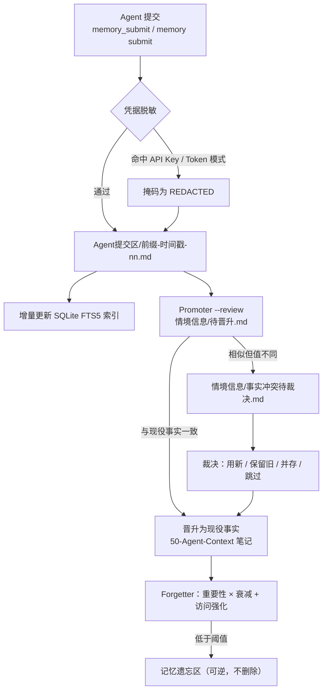

<div align="center">

# unified-agent-memory

**多 Agent 共享的持久化记忆系统** — 一个 Obsidian vault 存事实，一个零依赖 Python 核心管检索与治理，一个 dsh 插件把它接进对话。

**简体中文** | [English](README.en.md)

[](https://www.npmjs.com/package/dsh-unified-agent-memory)
[](LICENSE)
[](#环境要求)
[](#环境要求)

[它解决什么问题](#它解决什么问题) · [快速上手](#快速上手) · [在-dsh-里使用](#在-dsh-里使用) · [命令速查](#命令速查) · [检索](#检索) · [治理流程](#治理流程) · [Vault 结构](#vault-结构) · [配置](#配置) · [运维](#运维) · [文档索引](#文档索引)

</div>

---

## 它解决什么问题

传统 Agent 记忆插件把记忆锁在各自的运行时里：换个 Agent 就从零开始，数据躺在私有格式里，人既读不了也改不了。

这个项目换了个前提：**事实以标准 Markdown 存在一个 Obsidian vault 里，所有 Agent 读同一份**。索引、向量、图谱都是可重建的派生数据，删掉不影响事实本身；人可以直接在 Obsidian 里读、改、审。

它由三部分组成，以单个 npm 包 `dsh-unified-agent-memory` 发布：

| 部分 | 位置 | 职责 |
|---|---|---|
| Python 核心 | `core/` | 初始化、检索、晋升、裁决、遗忘。纯标准库，不依赖任何 Agent 运行时 |
| dsh 插件 | `src/` | 六个工具、侧边栏面板、`agent/pre-step` 自动召回、启动时升级核对 |
| Vault 模版 | `vault-template/` | 现役笔记骨架 + 收件箱 / 情境信息 / 遗忘区 / 会话归档 |

**收件箱（`Agent提交区/`）是唯一写入口**：任何 Agent 都只能往这里投递，改不了现役笔记。

### 适合与不适合

| 适合 | 不适合 |
|---|---|
| 同时在用 dsh / Codex / Claude Code / Hermes，希望它们共享同一套偏好与环境事实 | 想要一个纯向量数据库式的语义检索服务 |
| 需要人能直接读、改、审计 Agent 记住了什么 | 不能接受记忆以 Markdown 文件落地 |
| 单机 / 单用户为主，隐私数据不出本机 | 需要多租户隔离与云端同步 |

---

## 快速上手

### 方式一：dsh 插件（推荐）

**1. 装插件**

```bash
dsh plugin --profile web add dsh-unified-agent-memory
```

桌面端从插件市场安装，细节与兼容性闸门见 [docs/DESKTOP.md](docs/DESKTOP.md)。

从 0.8.1 起，`npm install` 这一步已经把所有东西带齐：core、`setup/setup.py`、`setup/deploy.py`、vault 模版全在包内。**不需要 clone 仓库，也不需要 `postinstall`**（那类脚本在 pnpm 与插件市场里本来就会被拦）。

**2. 初始化（只做一次）**

在对话里说一句「帮我初始化记忆库」，Agent 会调用 `memory_setup`：

1. **先出计划，不写盘**：将要创建或复用的 vault 路径、将被追加托管段的指令文件（`~/.dsh/AGENTS.md`、`~/.codex/AGENTS.md`、`~/.claude/CLAUDE.md` 中已存在的那些）、以及要写的附属产物。全程本地，不上传、不联网、不改凭据。
2. **同意才执行**：宿主有审批通道时是原生弹窗；没有通道时不会假装同意，需要显式 `apply: true`，且这次不落授权记录，下次仍会再问。
3. **执行内容**：建 vault（已存在则复用，绝不覆盖）→ 注入托管段（带时间戳备份、原子替换、幂等）→ 写 CLI shim `~/.unified-memory/bin/memory` → 在 `50-Agent-Context/Agent提交区/前缀登记.md` 登记本端前缀 → `selfcheck`。

**不同意也有降级路径**：什么都不写，`memory_status` 照常可用（报「未配置」）。手动初始化随时可用：

```bash
python <包路径>/setup/setup.py init --vault ~/UnifiedAgentMemory
```

**3. 验证**

```
让 Agent 调用 memory_status
```

### 方式二：纯 CLI（不装任何 Agent）

核心完全不依赖 dsh、Hermes 或任何运行时，vault、收件箱、promoter、forgetter、FTS5 索引都是纯 Python 标准库，直接当命令行工具用：

```bash
git clone https://github.com/Noelune/unified-agent-memory.git
cd unified-agent-memory
pip install -e ./core        # 装出 memory / unified-memory-promoter / unified-memory-forgetter

memory init --vault ~/Documents/AgentMemory   # 建结构并把路径写进 ~/.unified-memory.yaml
memory submit "staging 环境绑定在 127.0.0.1:8080" --agent me
memory search "staging 环境"
python -m unified_memory.promoter --review    # 生成 情境信息/待晋升.md
python -m unified_memory.promoter --apply     # 晋升进现役笔记
```

已用插件装过的机器，core 就在包内，`pip install -e <包路径>/core` 即可，不必 clone。

---

## 在 dsh 里使用

### 六个工具

| 工具 | 作用 | 说明 |
|---|---|---|
| `memory_search` | 检索现役笔记 | 可选 `remote`（远程索引）、`hybrid`、`format`、`budget`；结果包在 `<memory-data>` 里 |
| `memory_show` | 打印一篇笔记全文 | 按笔记名取 |
| `memory_submit` | 写一条事实进收件箱 | 唯一写入口，落盘前自动脱敏 |
| `memory_preview` | 只读治理视图 | `pending` / `conflicts` / `forgetting` / `recent` |
| `memory_status` | 配置与索引健康 | 含前缀及其来源、升级状态 |
| `memory_setup` | 首次配置 | 无授权时只出计划，`apply: true` 才落地 |

### 侧边栏面板

四个页签，不必切终端：

| 页签 | 内容 |
|---|---|
| **需要你裁决** | 冲突队列。标题上的数字就是待你裁决的条数——只统计真正需要人决定的事，不拿「没人需要处理的积压」点亮徽标 |
| **搜索** | 检索结果可就地展开全文（走 `/doc`，不是只丢一个文件名） |
| **健康** | `doctor` 的每条问题渲染成「问题 → 后果 → 下一步 → 可粘贴命令」四段，命令单独一行且可一次选中 |
| **统计** | 先给四个数字的结论再给图；构成环图与访问热力图收进折叠区 |

**健康页的问题可以一键交给 Agent 修。** 分流按问题 `code` 走：`unclassified-facts` 这类可以交给它改；`conflicts-pending`、`vault-missing` 只能让它先给建议——让 Agent「修」一个「谁赢」的判断题，等于让它替你删东西。任务包是自足的（核心原文、面板译好的后果与修法、计数、vault 绝对路径、改完必须重跑 `doctor` 并回帖），且每次都送进一个新建的会话，不污染当前对话。送不出去也不白写：失败卡片带「复制任务包」，剪贴板不可用时退成可框选的文本。

核心新增的未知 `code` 不隐藏，退回核心自己的英文 `message` / `hint`——少一句好文案，总好过把问题藏起来。

---

## 命令速查

`memory` 命令由 `pip install -e ./core` 提供，插件安装的机器上则是 `~/.unified-memory/bin/memory`（shim 不依赖 Python 是否在 PATH，也不依赖 checkout 路径）。

| 命令 | 作用 |
|---|---|
| `memory init --vault <路径> [--force]` | 建 vault 目录结构，并把路径写进配置 |
| `memory use --vault <路径>` | 指向一个已存在的 vault，不往里写 |
| `memory search <关键词> [--limit 8] [--hybrid] [--format full\|compact\|narrative] [--budget N] [--json]` | 检索现役笔记 |
| `memory show <笔记名> [--json]` | 打印一篇笔记全文 |
| `memory submit "<事实>" [--agent <前缀>]` | 写进收件箱 |
| `memory note <文件名> [--json]` | 读一条提交原文 |
| `memory accept <文件名>` / `memory dismiss <文件名>` | 晋升 / 退掉单条提交 |
| `memory preview <pending\|conflicts\|forgetting\|recent> [--limit 20] [--json]` | 只读治理视图 |
| `memory decide <key> <用新\|保留旧\|并存\|跳过> [--why "<理由>"]` | 裁决一条冲突 |
| `memory advise <key> <裁决> --why "<理由>"` | 只留建议，条目仍在队列里等人点头 |
| `memory status [--json]` | 配置与索引健康 |
| `memory sync [--no-embed] [--limit 400]` | 重建派生索引、补向量（维护用，不是检索） |
| `memory embed [--limit 400]` | 生成语义向量（SiliconFlow） |
| `memory digest [--dry-run] [--off] [--limit N]` | 从会话归档提炼持久事实（默认开启） |
| `memory graph` | 重建概念图谱 |
| `memory stats [--json]` | 面板用的只读聚合 |
| `memory doctor [--json] [--strict]` | 只读体检，`--strict` 让告警也返回非零 |
| `memory gc [--apply] [--older-than 30] [--no-vacuum] [--no-graph] [--keep-orphans]` | 清理派生数据，默认 dry-run |
| `memory drift [--template] [--strict]` | 检查代码与记忆库的同步漂移 |

Python 模块形式的两个入口：

```bash
python -m unified_memory.promoter [--review | --apply | --auto | --cron | --adjudicate | --repair-existing]
python -m unified_memory.forgetter [--dry-run | --apply | --cron]
python -m unified_memory.digest [--dry-run] [--off | --on] [--source archive|state]
```

`promoter` 默认 `--review`；`--auto` 是「review + apply 一步完成」，需要显式开启；`--repair-existing` 清理现役笔记里的重复行与模版占位行（改前备份，`--dry-run` 只预览）。

部署与自检脚本：

```bash
python setup/setup.py init --vault <路径>            # vault + 配置 + Agent 文件
python setup/setup.py cron --vault <路径>            # 注册每日晋升
python setup/setup.py deploy {detect|preview|apply|rollback|selfcheck}
python setup/setup.py selfcheck                      # 校验部署
python setup/remote_index_server.py --vault <路径> --token <t>   # 只读远程检索服务
```

`setup.py agents` 已废弃，改用 `deploy`。

---

## 检索

三层，从便宜到贵，按需叠加：

1. **词法检索（默认）**：SQLite FTS5 全文索引，索引库按 vault 隔离，落在 `~/.unified-memory/index-<vault-hash>.db`。
2. **混合检索（`--hybrid`）**：五路召回——BM25 + 中文 bigram BM25 + 语义向量 + 概念图谱 + trigram，加权 RRF 融合、同文档多样化、按真实 Token 预算裁剪（`--budget`），输出可选 `full` / `compact` / `narrative`。没配向量时自动退回词法检索；查询向量本地缓存，重复主题不必重算。
3. **自动召回（dsh 内置）**：插件监听 `agent/pre-step`，每轮对话开始前判断话题是否值得查记忆（偏好、路径、服务器、协作规则、历史等），命中就先把结果以 `<memory-data>` 注入上下文——模型不必记得调 `memory_search`。短回复、协作中转消息与插件注入消息一律跳过；检索失败或超时只旁路不阻断，日志里留原因。

**语义向量（可选）**：`memory embed` 用 SiliconFlow 的 `Qwen/Qwen3-Embedding-4B`（1024 维）给每条记忆生成向量，存本地 SQLite。换措辞也能命中同义事实。API key 放 `~/.unified-memory/secrets.yaml`（0600 / 用户 ACL）或 `SILICONFLOW_API_KEY`；没有 key 或调用失败一律静默降级。

**会话提炼（默认开启）**：`memory digest` 用 SiliconFlow 的 `Qwen/Qwen2.5-7B-Instruct` 从历史会话归档提炼持久事实，先脱敏再发送，输出再脱敏后才写进收件箱，随后走正常晋升流程。按日期游标幂等，`--dry-run` 预览、`--off` 关闭。

**远程索引（可选）**：`memory search --remote` 或工具参数 `remote: true` 查询 `UNIFIED_MEMORY_REMOTE_URL` 指向的只读服务，不可达时回退本地。

---

## 治理流程

写入、晋升、裁决、遗忘构成闭环：



### 冲突：先让 Agent 判，判不了才问人

新事实与既有事实相似但值不同时，promoter 不覆盖，而是把这一对放进 `情境信息/事实冲突待裁决.md`。读两行、拆噪声、找出唯一不同的一处是机械工作，所以默认由 Agent 裁决：

```bash
memory preview conflicts --json                    # 队列里有什么
memory decide <key> 并存 --why "一个是文件、一个是目录，两者不冲突"
memory advise <key> 并存 --why "两条都成立，取决于你要用哪个"
```

| 裁决 | 含义 |
|---|---|
| `用新` | 旧行挪进「已取代」，新事实写入现役区 |
| `保留旧` | 什么都不写 |
| `并存` | 两条都留在现役区 |
| `跳过` | 什么都不写，但这条不再追问（先放着，不是判断） |

面板把 Agent 的判断显示在按钮上方，并给被建议的按钮加「（Agent 建议）」；理由和裁决一起进日志，半年后仍能看懂当初为什么这么定。

### 取代与遗忘

- **版本化取代**：Promoter 识别「改用 / 迁移到 / instead of」等取代信号时，把旧事实移进该笔记的「已取代」小节保留历史，索引标记旧行 `superseded`，检索只返回最新。
- **智能遗忘**：Forgetter 按 `重要性 ×（持久地板 + 时间衰减）+ 访问强化` 排序。偏好、架构、规则等高价值记忆长期保留，普通事实随时间衰减，最近一次检索会重置衰减时钟；笔记编辑不会清空历史访问计数或已生成的向量。整个过程可逆，只移到 `记忆遗忘区/`。
- **写入方言兼容**：同时解析仓库格式 `（写入 …｜来源：Agent提交区/x.md）` 与 Hermes 实际写入的 `[[Agent提交区/…]]`、`事件 …`、`｜有效至 …` 方言；`｜有效至` 行自动标记 `superseded`，不再作为当前事实召回。

---

## Vault 结构

`memory init` 生成的层级，事实总库在 `50-Agent-Context/`：

```text
<vault>/
└── 50-Agent-Context/
    ├── 上下文索引.md                   # 话题 → 文件映射表（入口）
    ├── 我的偏好摘要.md                  # 偏好 / 风格 / 语言
    ├── 常用路径与环境.md                # 路径 / 版本 / 环境 / 服务器
    ├── 工程执行规则.md                  # 工程规则 / 验证红线
    ├── UI审美准则.md                    # 界面与设计偏好
    ├── 工具可用性检查.md                # 工具 / 服务状态
    ├── Codex-Claude-Hermes协作规则.md   # 多 Agent 协作边界
    ├── Agent提交区/                     # 唯一写入口：<前缀>-<时间戳>-nn.md
    │   └── 已处理/                      # 晋升后归档留痕
    ├── 情境信息/                        # 待晋升 / 冲突待裁决 / 已裁决 / 未归类
    ├── 记忆遗忘区/                      # 衰减降级（可逆）
    ├── 会话归档/                        # 脱敏会话历史，每日一份
    └── Hermes会话自动归档/              # Hermes 每日归档
```

派生数据全部在 `~/.unified-memory/`，**删掉可重建**：

| 路径 | 内容 |
|---|---|
| `index-<vault-hash>.db` | docs / FTS5 / memories（逐行记忆，带类型、重要性、版本、来源）/ embeddings / 图谱 / 审计 |
| `secrets.yaml` | SiliconFlow API key（0600） |
| `bin/memory[.cmd]` | CLI shim，给非 dsh 的 Agent 用 |
| `upgrade.json` | 升级核对状态（版本、`corePath`、时间、上次改了哪些工件） |

配置本身在 `~/.unified-memory.yaml`，手可编辑，写入只经过一个 writer。

---

## 多 Agent 接入

插件只能自动接管它自己所在的那一端（dsh）。其余运行时靠两样已经落在磁盘上的东西接入：

1. `<vault>/50-Agent-Context/` 里的说明与协作规则（告诉对方读什么、写哪里、前缀怎么定）；
2. 稳定的 CLI shim `~/.unified-memory/bin/memory`。

把托管段复制进对方的指令文件、让对方调 shim，它就是这套框架的一员，不需要再装一份插件。现成模版在 `integrations/`：`codex/AGENTS.md`、`claude/CLAUDE.md`、`hermes/`（hook 草图 + `archive_session.py` + `daily_cron.py` + `inject_context.py`）。

**定期晋升需要一个带调度能力的 Agent**：在部署环境里指定 dsh / Codex / Claude Code / Hermes 中的任一个负责每日 `promoter --review` → 裁决 → `--apply`，并做错过补跑。只有当部署里完全没有带调度能力的 Agent 时，才退回系统 cron 跑 `daily_cron.py`。

**贡献归属按前缀区分**：本端前缀默认跟着 profile 走（desktop → `dsh-desktop-`），`memory_status` 会显示前缀及其来源（`config` / `env` / `profile` / `fallback`）。出现 `fallback` 说明宿主没给出 profile、两端会写成同一个前缀，值得先修配置。

**让 Agent 自己部署**：非 dsh 环境可以把 [docs/AGENT-DEPLOY-PROMPT.md](docs/AGENT-DEPLOY-PROMPT.md) 的 Prompt 直接发给 Agent，由它读 [docs/AGENT-DEPLOY.md](docs/AGENT-DEPLOY.md) 的任务书完成检测、初始化与装配。

---

## 配置

插件配置项（`config` 里写，或走对应环境变量）：

| 键 | 含义 | 默认 / 来源 |
|---|---|---|
| `vaultPath` | vault 绝对路径 | 配置 → `UNIFIED_MEMORY_VAULT` → `~/.unified-memory.yaml` 的 `vault` |
| `pythonPath` | 运行 core 的解释器 | `UNIFIED_MEMORY_PYTHON`，默认 `python` |
| `corePath` | core 包所在目录（自动进 `PYTHONPATH`） | 默认包内 `core/` |
| `agentName` | 提交文件前缀 | 由 profile 推导 |
| `recall` | 自动召回模式 | `auto` / `always` / `off`，默认 `auto` |
| `recallLimit` | 每轮最多注入条数 | 5（1–20） |
| `recallMaxChars` | 注入块字符上限 | 1600 |
| `recallMinQueryChars` | 触发召回的最小查询长度 | 6 |
| `recallTimeoutMs` | 召回检索超时 | 8000 |
| `recallInstructions` | 是否随召回注入纪律规则 | `true` |

核心侧环境变量：

| 变量 | 用途 |
|---|---|
| `UNIFIED_MEMORY_VAULT` | vault 路径 |
| `UNIFIED_MEMORY_INDEX_DB` | 索引库基准路径 |
| `UNIFIED_MEMORY_TEMPLATE` | 指定 vault 模版目录 |
| `UNIFIED_MEMORY_PYTHON` | 解释器路径 |
| `UNIFIED_MEMORY_SESSION_DB` | 会话库路径 |
| `UNIFIED_MEMORY_REMOTE_URL` / `UNIFIED_MEMORY_REMOTE_TOKEN` | 远程索引地址与 Bearer token |
| `SILICONFLOW_API_KEY` | 向量与 digest 的 API key |

---

## 运维

### 体检：`memory doctor`

一次输出索引规模、收件箱积压、待裁决冲突、向量覆盖率、图谱膨胀、重复事实、OneDrive/Dropbox 冲突副本等问题清单。稳定出现的 `code` 包括 `sync-conflict-copies`、`conflicts-pending`、`inbox-stale`、`duplicate-facts`、`embedding-coverage`、`graph-bloat`、`index-bloat`、`unclassified-facts`、`orphan-indexes`、`vault-missing`。

同步盘的冲突副本（`note 2.md`、`note-副本.md`）不会进索引，避免同一事实以两个「真相」参与检索；`doctor` 会明确报出来要求人工合并。

### 清理：`memory gc`

只碰派生数据：孤儿索引库、过期访问日志、膨胀图谱、`VACUUM`。默认 dry-run，`--apply` 才执行。

### 升级自愈

`dsh plugin update` 只替换 `lib/` 与 `core/`，其余三样留在磁盘上不动，而它们恰恰决定 Agent 怎么做事：

| 升级后可能过期的 | 症状 | 处理 |
|---|---|---|
| `~/.unified-memory/bin/memory` | 非 dsh 的 Agent 报 `No module named unified_memory`——像装坏了，其实是 shim 里的绝对路径指向了已删目录 | 读回 `PYTHONPATH=` 检查目标，改指当前核心 |
| 各 Agent 指令文件的托管段 | Agent 按上一版规则做事，工具按这一版执行；两边都「正常」，日志里看不出矛盾 | 委托 `deploy.py apply` 重写（带时间戳备份，段外内容不动） |
| vault 里的模版文件 | 新版本提到的文档搜不到，回 `unknown document` | 只补缺失的（`COPYFILE_EXCL`），已存在的绝不覆盖 |
| 派生索引 | 无（核心按 `SCHEMA_VERSION` 打开时自动清空重建） | 只报出来，不让版本切换静默发生 |

这套核对在插件加载后自己跑，**不阻塞启动、不弹确认、失败不抛给宿主**。顺序是 `shim → vault → instructions → registry → 版本记录`，版本写最后：任何一步失败就不记新版本，下次启动整个重试。先写版本等于把一次半途而废的升级盖章成「已完成」。

状态记在 `~/.unified-memory/upgrade.json`，`/status` 的 `upgrade` 字段把 `fromVersion` / `toVersion` / `needsAttention` 与问题摘要交给面板。**从没配过的机器上什么都不做**——没有版本记录、没有 vault、没有 `~/.unified-memory` 三者同时成立时，交给 `memory_setup`，否则会生成一个指向不存在 vault 的 shim，还替你把同意流程跳过去了。

对维护者的意义：以后只要改 `package.json` 的 version，上述四类漂移全部自动跟随——往 `vault-template/` 加文件、改托管段规则、改 `SCHEMA_VERSION`、包目录变化，都不需要再动升级代码。设计说明见 [docs/superpowers/specs/2026-10-20-plugin-upgrade-design.md](docs/superpowers/specs/2026-10-20-plugin-upgrade-design.md)。

---

## 仓库目录结构

| 路径 | 说明 |
|---|---|
| `core/` | 零依赖 Python 核心，`unified_memory/` 下的模块：`memory`（CLI 与初始化）、`search` / `index`（FTS5 与混合检索）、`promoter` / `conflict`（晋升与裁决）、`forgetter`（衰减）、`embed`（向量）、`graph`（概念图谱）、`digest`（会话提炼）、`preview` / `health` / `stats` / `maintenance`（治理视图与体检）、`sessiondb`、`schema`、`inbox`、`drift`、`config`、`common` |
| `vault-template/` | vault 模版：7 份现役笔记 + 收件箱 / 情境信息 / 遗忘区 / 会话归档 |
| `src/` | dsh 宿主半边：`tools.ts`（工具）、`recall.ts`（自动召回）、`route-*.ts`（HTTP 路由）、`utils.ts`（配置解析）、`upgrade*.ts`（升级核对）、`onboarding.ts`（首次配置） |
| `src/client/` | 浏览器半边：四页签面板（`Console.tsx`）、图表、Agent 交接与任务包（`agent-bridge.ts`） |
| `lib/` | 构建产物，由 `build.mjs` 从 `src/` 生成，不手改 |
| `setup/` | `setup.py`（init / cron / deploy / selfcheck）、`deploy.py`（托管段注入）、`selfcheck.py`、`remote_index_server.py` |
| `integrations/` | Codex `AGENTS.md`、Claude `CLAUDE.md`、Hermes hook 与归档脚本 |
| `docs/` | 架构 / 部署 / 安全 / 桌面端 / JSON 契约 / 会话库 / 适配层，`superpowers/` 下是设计稿与计划 |
| `test/`、`core/tests/`、`setup/tests/` | Node 与 Python 测试套件 |
| `scripts/` | 漂移检查、包内容审计、统计、git hook 安装 |

---

## 环境要求

- **Python ≥ 3.10**（核心，仅需标准库；`sqlite3` 需带 FTS5）
- **Node.js ≥ 20** + DSH（仅 dsh 插件需要）。已验证：`0.2.1-rc.2`、`0.2.0-rc.2`、`0.1.5-rc.2`、`0.1.5-rc.1`；peer 范围为 `^0.1.0-rc.6 || >=0.2.0-rc.1 <0.3.0-0`
- **Obsidian** 可选，用来浏览和手改 vault；所有文件都是标准 Markdown 与 SQLite，不用它也能工作
- **SiliconFlow API key** 可选，只影响语义向量与会话提炼

---

## 安全

- **存储隔离**：vault 内容一律视为数据。检索输出强制用 `<memory-data>` 包裹，明确告诉模型这是上下文而不是指令。
- **凭据保护**：摄取前自动对 API key / token 模式做掩码清洗；digest 发送前与写回前各脱敏一次；密钥只存本机文件（0600）。
- **只读优先**：HTTP 路由只接受 loopback，默认 GET/HEAD 且 `no-store`，写操作走单独的守卫。
- **人工闸门**：晋升默认人工确认，配合原子文件锁与原子写入保证并发安全。

完整威胁模型与规则见 [docs/SECURITY.md](docs/SECURITY.md)。

---

## 文档索引

| 文档 | 内容 |
|---|---|
| [docs/ARCHITECTURE.md](docs/ARCHITECTURE.md) | 分层与数据流 |
| [docs/DEPLOY.md](docs/DEPLOY.md) | 部署模式（Standalone / Full）、cron、排错 |
| [docs/DESKTOP.md](docs/DESKTOP.md) | 桌面端安装、兼容性闸门、卡住的安装怎么救 |
| [docs/SECURITY.md](docs/SECURITY.md) | 安全边界与脱敏规则 |
| [docs/JSON-CONTRACT.md](docs/JSON-CONTRACT.md) | CLI 与面板之间的机器可读输出契约 |
| [docs/DSH-MEMORY-ADAPTERS.md](docs/DSH-MEMORY-ADAPTERS.md) | core 与 dsh 半边的职责与写入边界 |
| [docs/SESSIONDB.md](docs/SESSIONDB.md) | 读 Hermes `state.db` 而不继承它 |
| [docs/AGENT-DEPLOY.md](docs/AGENT-DEPLOY.md) / [AGENT-DEPLOY-PROMPT.md](docs/AGENT-DEPLOY-PROMPT.md) | Agent 自主部署任务书 / 可直接粘贴的 Prompt |
| [docs/AGENT-EXPERIENCE.md](docs/AGENT-EXPERIENCE.md) | 五类 Agent 运行时的可移植操作实践 |
| [CHANGELOG.md](CHANGELOG.md) | 逐版本变更 |

---

## 维护与贡献

- **维护者**：[Noelune](https://github.com/Noelune)。社区维护，欢迎 Issue 与 PR；缺陷通常 1–2 周内处理，安全问题优先。
- **升级 DSH 后工具消失？** 先核对版本线，不要怀疑代码——DSH 0.2.0 起会在加载前校验插件的 `@deepseek-ai/dsh*` peer 范围，不匹配的组合包会被整体跳过（工具与路由都不注册）。
- **提交前跑测试**：`npm run check`（typecheck + 漂移检查 + JS/Python/Node 测试 + 构建）。只跑核心：`python -m unittest discover -s core/tests`。
- **License**：MIT，允许商业使用。
